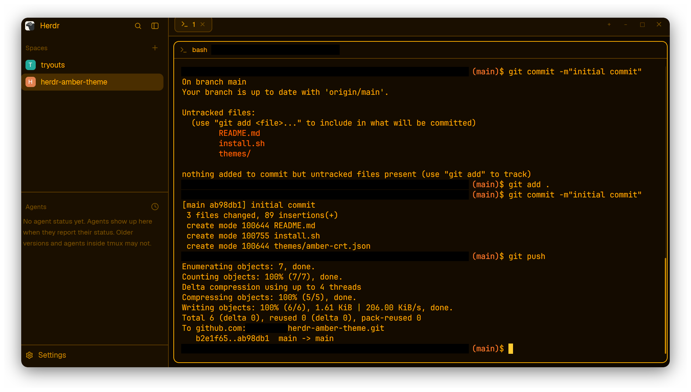

# Herdr Amber Theme

An amber-phosphor theme (`amber-crt`) for [Herdr](https://github.com/herdrdev/herdr),
inspired by Cool Retro Term: dark brown background, amber text and cursor, amber
sidebar, tab bar and status bar.

Herdr cannot change how terminals draw text, so there are no flicker, glow or
scanline effects, only the colors.



## Install

Quick way:

```sh
./install.sh
```

This copies `themes/amber-crt.json` to `~/.config/herdr-app/themes/` and, if Herdr
is running, activates the theme.

Manual way:

```sh
mkdir -p ~/.config/herdr-app/themes
cp themes/amber-crt.json ~/.config/herdr-app/themes/
herdr-app do app.theme --name amber-crt
```

Alternatively pick `amber-crt` in Herdr's Settings. If you use a custom
`HERDR_APP_HOME`, `install.sh` respects it.

## Switch back

```sh
herdr-app do app.theme --name graphite   # or ink, moss, paper
```

## Customize

All colors are in `themes/amber-crt.json`; changes apply live.
The top level (`background`, `foreground`, `selection`, `cursor`, `ansi`) is the
terminal, `colors` is the interface (sidebar, tabs, borders, accents).

## Uninstall

```sh
rm ~/.config/herdr-app/themes/amber-crt.json
```
